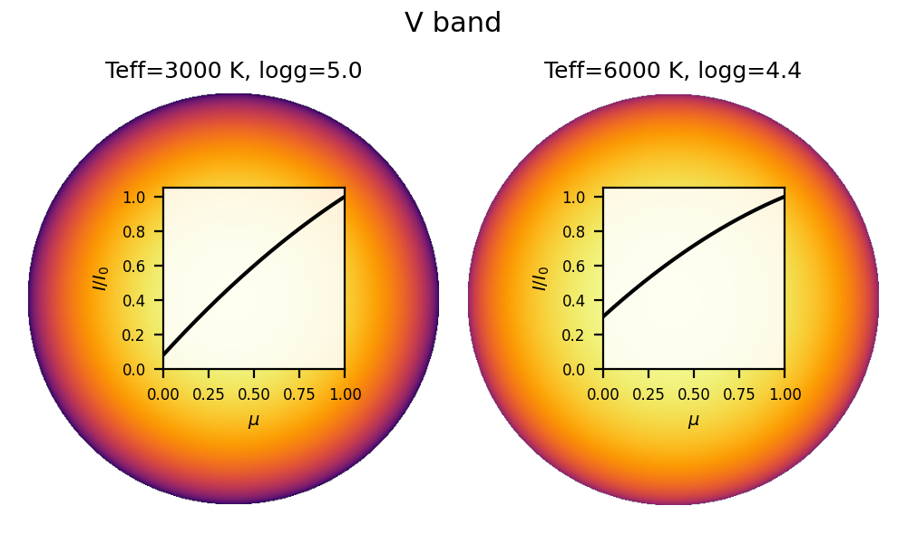
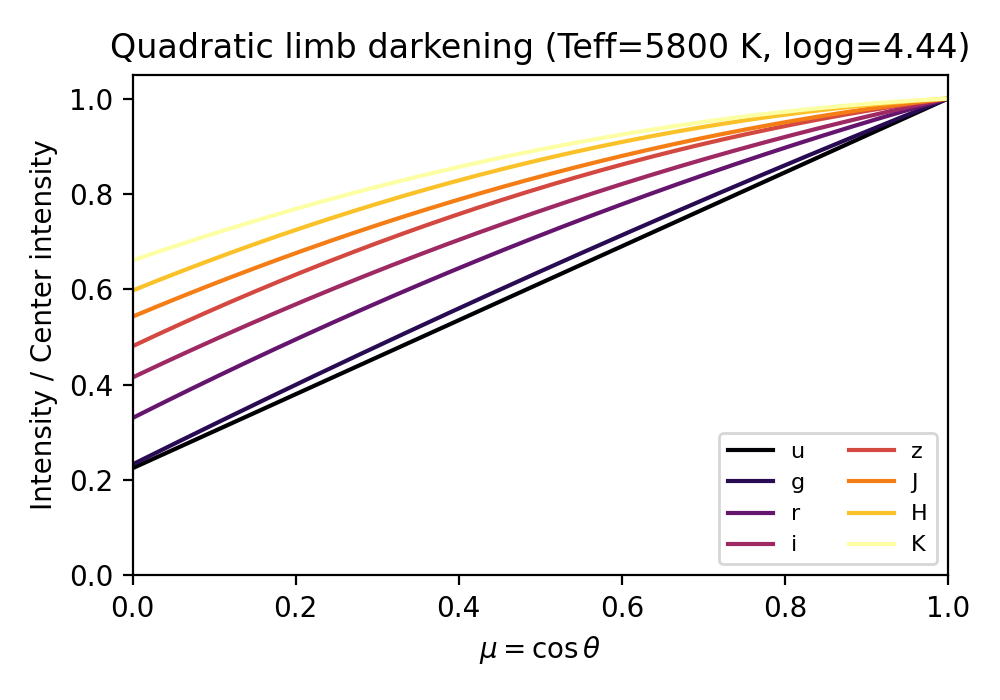
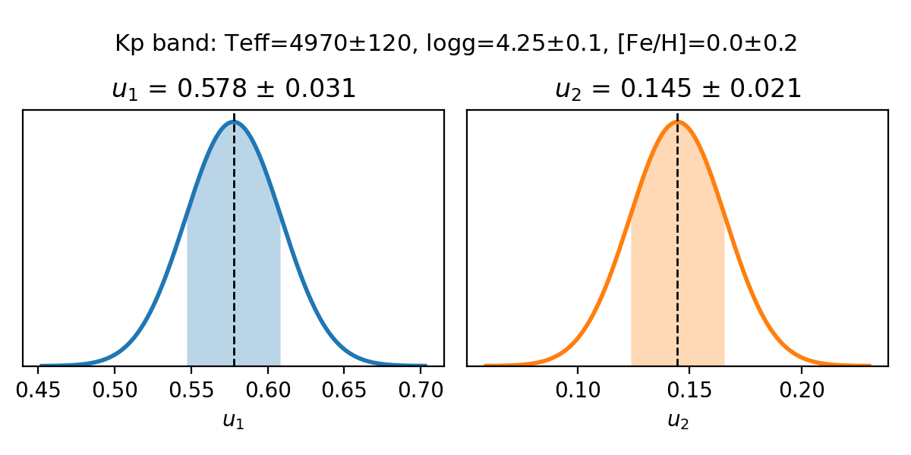

# limbdark

Gaussian priors for limb darkening coefficients from [Claret & Bloemen (2011)](https://ui.adsabs.harvard.edu/abs/2011A%26A...529A..75C) and [Claret (2017)](https://ui.adsabs.harvard.edu/abs/2017A%26A...600A..30C).

Uses Monte Carlo interpolation to propagate uncertainties in stellar parameters (Teff, logg, [Fe/H]) to uncertainties in limb darkening coefficients for Bayesian transit analysis.





## Installation

```bash
pip install git+https://github.com/john-livingston/limbdark
```

## Quick start

### Python

```python
import limbdark as ld

u1, u1_err, u2, u2_err = ld.claret(
    band='Kp',
    teff=4970, uteff=120,
    logg=4.25, ulogg=0.03,
    feh=0.0, ufeh=0.2
)
```

### Command line

```bash
limbdark --teff 4970,120 --logg 4.25,0.03 --feh 0,0.2 --band Kp
```

## How it works

For a given photometric band and limb darkening law, `limbdark` interpolates the Claret tables on a 3D grid of (Teff, logg, [Fe/H]) to obtain limb darkening coefficients. Uncertainties are propagated by drawing Monte Carlo samples from the stellar parameter distributions and interpolating each sample on the grid. The resulting distributions of limb darkening coefficients can be summarized as Gaussian priors for use in transit fitting.


